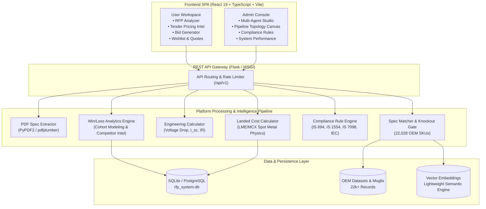

# ⚡ Haki FMCG 2.0 — Enterprise RFP & Bid Intelligence Platform

[](https://github.com/CodeWizardAn/rfp_haki)
[](https://github.com/CodeWizardAn/rfp_haki/tree/main/haki-fmcg-frontend)
[](https://github.com/CodeWizardAn/rfp_haki)
[](LICENSE)
[](https://vercel.com)

> **Next-generation autonomous multi-agent procurement platform for heavy electrical, wires & cables manufacturing, government GeM tendering, and industrial enterprise bids.**

---

## 📖 Overview

**Haki FMCG 2.0** automates the entire end-to-end lifecycle of technical tender discovery, RFP parsing, multi-tier spec matching, physical engineering calculations, spot metal index pricing, and standard compliance verification.

Engineered specifically for the electrical infrastructure domain (power cables, control cables, flexible wires, and high-voltage transmission), the platform matches tender specifications against an active database of **22,000+ OEM products** (Polycab, Finolex, Havells, KEI, RR Kabel, and Moglix Marketplace) while enforcing strict gatekeeper knockouts and dynamic landed cost physics.

---

## 🌟 Key Capabilities

### 🔍 1. Autonomous RFP Ingestion & Spec Extraction
- High-fidelity extraction from unstructured GeM / e-Procure tender PDFs.
- Regularized token-level entity identification for conductor materials (Copper / Aluminium), insulation chemistry (PVC, XLPE, FRLS, ZHFR), voltage classes ($1.1\text{ kV}$ to $33\text{ kV}$), cross-sections ($1.5$ to $630\text{ mm}^2$), and core configurations ($1\text{C}$ to $4\text{C}$).

### 🎯 2. Gatekeeper Knockout & OEM Catalog Matching
- Matches tender items against **22,028 verified manufacturer SKUs**.
- **Hard Gatekeeper Knockouts**: Strict disqualification filters (e.g., Copper offered for an Aluminium mandate, or low-voltage PVC offered for $33\text{ kV}$ requirements).
- Multi-vector similarity scoring combining electrical spec proximity and dimensional match.

### 🔬 3. Physical & Engineering Formula Validation
- **Voltage Drop Analysis**:
  $$V_d = \frac{\sqrt{3} \cdot I \cdot L \cdot \rho}{A \cdot 1000}$$
  Evaluates conductor length, rated ampacity, and material resistivity ($\rho_{\text{Al}} \approx 1.6\times \rho_{\text{Cu}}$).
- **Short Circuit Thermal Withstand Capacity**:
  $$I_{sc} = \frac{k \cdot A}{\sqrt{t}}$$
  Computes adiabatic thermal limits based on standard adiabatic constants ($k = 143$ for Cu/XLPE, $94$ for Al/XLPE).
- **Insulation Resistance (IR)**:
  $$IR = \frac{k \cdot \log_{10}(D/d)}{L}$$
  Dynamically scales volume resistivity inversely with cable run length.

### 📈 4. Real-Time Commodity Index Pricing & Landed Cost Physics
- Conductor metal mass computation based on core geometry and metal density:
  $$W_{\text{metal}} = n_{\text{cores}} \cdot A_{\text{nominal}} \cdot L \cdot \rho_{\text{metal}}$$
- Live spot pricing integration with **MCX & LME indices** (Copper & Aluminium).
- End-to-end landed cost build-up: base metal weight, compounding/extrusion margins, drum packing, logistics/freight, transit insurance, and statutory GST (18%).

### 🛡️ 5. Compliance & Regulatory Rules Engine
- Automated verification against national and international standards:
  - **IS 694**: PVC insulated wires for working voltages up to and including $1100\text{V}$.
  - **IS 1554 (Part 1)**: PVC insulated heavy-duty electric cables.
  - **IS 7098 (Part 1 & 2)**: Crosslinked polyethylene (XLPE) insulated cables up to $33\text{ kV}$.
  - **IEC 60502 / IS 8130**: Conductors for insulated electric cables and testing methods.
  - Continuous operating temperature validation ($-40^\circ\text{C}$ to $+105^\circ\text{C}$) and BIS / ISI certification auditing.

### 📊 6. Historical Win/Loss Bid Analytics
- RFP cohort tracking with reproducible seed heuristics.
- Transparent margin and win-ratio analytics ($\text{Won Value} + \text{Lost Value} \equiv \text{Total Value}$).
- Competitor pricing distribution modeling and win probability recommendations.

### 📜 7. IEEMA Price Variation Clause (PVC) Statutory Engine
- Formal circular formula adjustments for long-delivery PSU / GeM contracts:
  $$P = P_0 \left( a + b \frac{\text{Cu}}{\text{Cu}_0} + c \frac{\text{Al}}{\text{Al}_0} + d \frac{\text{CC}}{\text{CC}_0} + e \frac{\text{Fe}}{\text{Fe}_0} \right)$$
- Supports LT Aluminium/Copper, HT XLPE transmission, and flexible wire categories with full factor contribution auditing.

### 📋 8. Schedule of Technical Deviations (Form F-4) & Statutory EMD Exemptions
- Automated generation of clause-by-clause tender deviation sheets with risk grading (Nil, Minor, Major Technical, Commercial).
- Instant Form F-4 CSV export ready for GeM / CPPP upload.
- Automated EMD / PBG exemption evaluations for MSME (Udyam), DPIIT Startups, and NSIC registered vendors.

---

## 🏗️ System Architecture



---

## 💻 Tech Stack

| Layer | Technologies |
| :--- | :--- |
| **Frontend** | React 19, TypeScript, Vite, Tailwind CSS, Framer Motion, Recharts, Lucide React, Zustand, React Router 7 |
| **Backend** | Python 3.11+, Flask, SQLAlchemy, SQLite / PostgreSQL, NumPy, PyPDF2, pdfplumber |
| **Intelligence** | Lightweight Semantic Embeddings, Custom Physics Calculators, Knockout Rule Evaluator |
| **DevOps / Hosting** | Vercel (Frontend SPA), Docker, Docker Compose, Nginx, Gunicorn |

---

## 📂 Project Structure

```bash
Haki_FMCG_2.0/
├── agents/                       # Autonomous agent implementations
│   ├── sales_agent/              # RFP scanning & commercial opportunity intake
│   ├── technical_agent/          # Engineering spec extraction & compliance
│   ├── master_agent/             # Orchestrator & cross-agent communication
│   └── shared/                   # Shared metrics & performance monitors
├── analytics/                    # Win/Loss modeling & bid cohort intelligence
├── api/                          # REST API controllers & route handlers
│   └── rest_api.py               # Main Flask API gateway (v1)
├── compliance_and_standards/     # IS 694 / IS 1554 / IS 7098 compliance rules
├── database/                     # DB engine, vector store, and SQLite schema
├── haki-fmcg-frontend/           # React 19 TypeScript SPA
│   ├── src/
│   │   ├── components/           # Reusable UI cards, tables, modals, charts
│   │   ├── hooks/                # React Query & API consumption hooks
│   │   ├── layouts/              # AdminLayout & UserLayout wrappers
│   │   ├── pages/                # 40+ Enterprise dashboards & analyzers
│   │   └── services/             # Axios API service bindings
│   ├── package.json
│   └── vite.config.ts
├── pdf_extraction/               # PDF text extraction & regularized parsing
├── spec_comparer/                # 22k product matcher & engineering calculator
├── wires_cables_data/            # Normalized OEM catalogs (Polycab, Finolex, etc.)
├── price_optimization.py         # Metal commodity index & landed cost engine
├── pipeline_connector.py         # End-to-end pipeline execution coordinator
├── test_core_functions_fidelity.py # Comprehensive 16-point math & logic audit
├── docker-compose.yml            # Multi-container orchestration
├── requirements.txt              # Backend Python dependencies
└── vercel.json                   # Vercel SPA rewrite & deployment rules
```

---

## 🚀 Quickstart Guide

### 1. Prerequisites
- **Node.js**: v18.x or v20.x+
- **Python**: v3.11+
- **npm** or **yarn**

### 2. Backend Setup
```bash
# Clone the repository
git clone https://github.com/CodeWizardAn/rfp_haki.git
cd rfp_haki

# Create and activate virtual environment
python -m venv venv
# Windows:
venv\Scripts\activate
# Linux/macOS:
source venv/bin/activate

# Install dependencies
pip install -r requirements.txt

# Run the backend API server (runs on port 8000)
python api/rest_api.py
```

### 3. Frontend Setup
```bash
# Navigate to frontend directory
cd haki-fmcg-frontend

# Install dependencies
npm install

# Start Vite development server (runs on port 5173 or 3000)
npm run dev
```

### 4. Running with Docker Compose
```bash
# From the project root
docker-compose up --build
```

---

## 🔑 Demo Access Credentials

The platform features built-in demo credentials for immediate testing:

| Role | Username | Password | Access Scope |
| :--- | :--- | :--- | :--- |
| **Administrator** | `admin` | `admin123` | Full Access: Multi-Agent Orchestration Studio, Pipeline Canvas, Compliance Rules, System Tuning |
| **Enterprise User** | `user` | `user1234` | Workspace Access: RFP Analyzer, Tender Intel, Landed Cost Calculator, Bid Generation |

---

## 🧪 Testing & Verification

A dedicated fidelity and mathematical verification test suite is included in the root directory:

```bash
# Execute comprehensive 16-point core function verification
python test_core_functions_fidelity.py
```

**Validated subsystems:**
- ✅ Spec tokenization across copper, aluminium, armored, and unarmored cables.
- ✅ Gatekeeper knockout rejection filters against 22,028 catalog items.
- ✅ Physical scaling laws: Voltage Drop, Short Circuit Capacity ($I_{sc}$), and Insulation Resistance.
- ✅ Live metal price sensitivity (MCX/LME delta tracking + 18% GST).
- ✅ Standards compliance scoring under IS 694, IS 1554, IS 7098, and IEC 60502.

---

## 📄 License

Proprietary enterprise software developed for **Haki FMCG**. All rights reserved.
