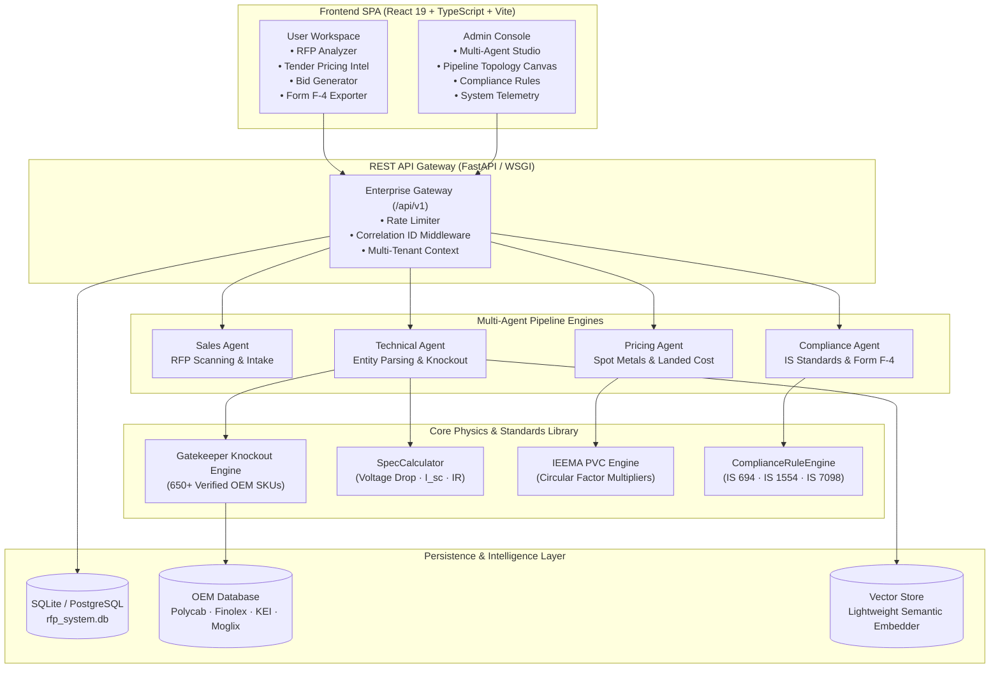

<div align="center">

# HAKI FMCG 2.0

### Autonomous Multi-Agent Procurement &amp; Bid Intelligence Platform

An enterprise tendering operating system where specialized AI agents autonomously ingest complex GeM / e-Procure tender specifications, match against 650+ OEM products, calculate electrical physics, and engineer landed cost margins.

**[⚡ Live Deployment](https://rfp-haki.vercel.app/)** · **[Explore Architecture](#-system-architecture)** · **[IEEMA PVC Engine](#-ieema-price-variation-clause-pvc-engine)** · **[Form F-4 Deviations](#-schedule-of-technical-deviations-form-f-4)** · **[Quickstart](#-quickstart-guide)**

[](https://rfp-haki.vercel.app/)
[](https://github.com/CodeWizardAn/rfp_haki/tree/main/haki-fmcg-frontend)
[](https://github.com/CodeWizardAn/rfp_haki)
[-10B981?style=flat-square)](test_core_functions_fidelity.py)
[](LICENSE)

[Platform Website](https://rfp-haki.vercel.app/) · [API Documentation](http://localhost:8000/docs) · [Contribute](CONTRIBUTING.md) · [Security Policy](SECURITY.md)

</div>

---

## ⚡ One Platform for the Entire Tendering Lifecycle

Keep the tender document you are analyzing beside the active AI agent working on it. Extract engineering line items, enforce gatekeeper knockouts, price raw metal commodities, and export statutory bid schedules from a single unified workspace.

| Ingest &amp; Extract | Physics &amp; Match | Price &amp; Win |
| :--- | :--- | :--- |
| **Autonomous Spec Extractor** parses unstructured GeM and PSU tender PDFs, identifying conductor metals, insulation types, cross-sections ($1.5$ to $630\text{ mm}^2$), and voltage classes ($1.1\text{ kV}$ to $33\text{ kV}$). | **Gatekeeper Knockout Engine** queries **650+ verified OEM SKUs** (Polycab, Finolex, Havells, KEI, RR Kabel, Moglix) with strict disqualification gates while **SpecCalculator** validates voltage drop, short-circuit withstand, and IR. | **Metal Spot Index &amp; IEEMA PVC** tracks live LME / MCX indices (Copper, Aluminium), calculates turnkey landed cost physics with 18% GST, and exports GeM Form F-4 Technical Deviation Statements. |

---

## 🤖 Run Autonomous Procurement Agents

Bring specialized AI agents together in a synchronized multi-agent orchestration topology:

```
Master Orchestrator ──┬──► Sales Agent (RFP Intake & Discovery)
                      ├──► Technical Agent (Entity Tokenization & Spec Knockout)
                      ├──► Pricing Agent (Spot Metal Mass & Turnkey Landed Cost)
                      └──► Compliance Agent (IS 694 / IS 1554 / IS 7098 & Form F-4)
```

The agents coordinate across active pipeline stages: reading tender PDFs, querying the vector database, calculating dimensional weights, and formulating commercial bid proposals.

### From Tender Document to Winning Bid Submission

<table>
<tr>
<td width="50%" valign="top">

### 1. Ingest &amp; Extract Specifications
Upload tender documents from GeM, NTPC, PGCIL, or State Discoms. The extractor tokenizes line items into structured electrical criteria:

```json
{
  "cross_section_sqmm": 50.0,
  "cores": 4,
  "conductor_material": "Aluminium",
  "insulation_type": "XLPE",
  "is_armoured": true,
  "voltage_rating": 1100.0
}
```
<sub>Tokenized entity extraction handles mixed bilingual and non-standard tender formatting.</sub>

</td>
<td width="50%" valign="top">

### 2. Knockout Filter &amp; Catalog Matching
Evaluates the requirement against **650+ manufacturer products**. Enforces strict disqualification gates:

- ❌ **Disqualified**: Copper offered for Aluminium requirement.
- ❌ **Disqualified**: 650V cable offered for 33kV transmission.
- ✅ **Ranked Matches**: Polycab, KEI, Finolex, Havells sorted by specification proximity and availability score.

</td>
</tr>
<tr>
<td width="50%" valign="top">

### 3. Electrical Physics &amp; Landed Costing
Computes dimensional metal volume and true raw material weight:

$$W_{\text{metal}} = n_{\text{cores}} \cdot A_{\text{nominal}} \cdot L \cdot \rho_{\text{metal}}$$

- **Voltage Drop**: $V_d = \frac{\sqrt{3} \cdot I \cdot L \cdot \rho}{A \cdot 1000}$
- **Short Circuit Limit**: $I_{sc} = \frac{k \cdot A}{\sqrt{t}}$
- **Landed Cost**: Base metal + compounding + wooden drums + freight per tonne-km + 18% GST.

</td>
<td width="50%" valign="top">

### 4. Statutory IEEMA PVC &amp; Form F-4 Export
Generates statutory bid schedules ready for GeM / CPPP upload:

- **IEEMA Price Variation**: Adjusts delivery milestone invoices against circular indices for Copper, Aluminium, PVC, and Steel armouring.
- **Form F-4 Schedule of Deviations**: Clause-by-clause compliance matrix with risk rating (Nil, Minor, Major, Commercial).
- **EMD / PBG Exemptions**: Automatic Rule 170 GFR 2017 exemptions for MSME (Udyam) and DPIIT Startups.

</td>
</tr>
</table>

---

## 📜 IEEMA Price Variation Clause (PVC) Engine

In institutional PSU and government tenders, fixed price bids are legally prohibited for long-delivery electrical contracts. The platform implements official **IEEMA circular formulas**:

$$P = P_0 \cdot \left[ a + b\frac{\text{Cu}}{\text{Cu}_0} + c\frac{\text{Al}}{\text{Al}_0} + d\frac{\text{CC}}{\text{CC}_0} + e\frac{\text{Fe}}{\text{Fe}_0} + f\frac{\text{Labour}}{\text{Labour}_0} \right]$$

### Factor Distributions by Cable Division:

| Cable Category | Fixed ($a$) | Copper ($b$) | Aluminium ($c$) | Polymer ($d$) | Steel ($e$) | Labour ($f$) |
| :--- | :---: | :---: | :---: | :---: | :---: | :---: |
| **LT Aluminium XLPE Armoured** | 0.20 | 0.00 | **0.35** | 0.15 | 0.15 | 0.15 |
| **LT Copper XLPE Armoured** | 0.15 | **0.60** | 0.00 | 0.12 | 0.08 | 0.05 |
| **HT XLPE Aluminium Armoured** | 0.20 | 0.00 | **0.40** | 0.18 | 0.12 | 0.10 |
| **Flexible Copper PVC Wires** | 0.15 | **0.70** | 0.00 | 0.15 | 0.00 | 0.00 |

*Accessible via REST API:* `POST /api/v1/procurement/ieema-pvc`

---

## 📋 Schedule of Technical Deviations (Form F-4)

Every government and enterprise bid submission mandates a formal **Schedule of Technical Deviations**. The platform automatically compares tender requirements against the selected OEM product and generates the statutory compliance matrix:

| Clause No. | Tender Parameter | Specified Requirement | Offered Specification | Deviation Category | Risk Level | Status |
| :--- | :--- | :--- | :--- | :--- | :---: | :---: |
| **Clause 2.1** | Conductor Metallurgy | Aluminium Grade | Electrolytic Aluminium | **NIL** | NONE | ✅ COMPLIANT |
| **Clause 2.2** | Cross-Section Area | $50.0\text{ mm}^2$ | $70.0\text{ mm}^2$ | **MINOR_TECHNICAL** | LOW | 🌟 SUPERIOR |
| **Clause 3.1** | Insulation Dielectric | XLPE | XLPE Insulation | **NIL** | NONE | ✅ COMPLIANT |
| **Clause 4.1** | Voltage Rating | $1100\text{V}$ Grade | $1100\text{V}$ Conforming | **NIL** | NONE | ✅ COMPLIANT |

*Includes 1-click statutory CSV export ready for GeM portal attachment via:* `POST /api/v1/procurement/technical-deviations`

---

## 🏗️ System Architecture



---

## 💻 Tech Stack

| Layer | Technologies |
| :--- | :--- |
| **Frontend** | React 19, TypeScript, Vite, Tailwind CSS, Framer Motion, Recharts, Lucide React, Zustand, React Router 7 |
| **Backend** | Python 3.11+, FastAPI, SQLAlchemy, SQLite / PostgreSQL, NumPy, PyPDF2, pdfplumber |
| **Intelligence** | Lightweight Semantic Embeddings, Conductor Weight Physics, Knockout Rule Evaluator |
| **DevOps & CI** | Vercel (Frontend SPA), Docker, Docker Compose, Nginx, GitHub Actions |

---

## 🚀 Quickstart Guide

### 1. Prerequisites
- **Node.js**: v18.x or v20.x+
- **Python**: v3.11+
- **Git**

### 2. Backend Setup
```bash
# Clone the repository
git clone https://github.com/CodeWizardAn/rfp_haki.git
cd rfp_haki

# Create and activate virtual environment
python -m venv venv
# Windows:
venv\Scripts\activate
# Linux/macOS:
source venv/bin/activate

# Install dependencies
pip install -r requirements.txt

# Start backend REST API server (runs on http://localhost:8000)
python api/rest_api.py
```

### 3. Frontend Setup
```bash
# Navigate to frontend directory
cd haki-fmcg-frontend

# Install dependencies
npm install

# Start Vite development server (runs on http://localhost:5173)
npm run dev
```

### 4. Running with Docker Compose
```bash
# From repository root
docker-compose up --build
```

---

## 🔑 Built-in Demo Credentials

The platform features built-in demo credentials for immediate testing:

| Role | Username | Password | Access Scope |
| :--- | :--- | :--- | :--- |
| **Administrator** | `admin` | `admin123` | Full Access: Multi-Agent Orchestration Studio, Pipeline Canvas, Compliance Rules, System Tuning |
| **Enterprise User** | `user` | `user1234` | Workspace Access: RFP Analyzer, Tender Intel, Landed Cost Calculator, Bid Generation, Form F-4 |

---

## 🧪 Comprehensive Fidelity & Physics Test Suite

A dedicated mathematical audit suite validates all platform algorithms:

```bash
python test_core_functions_fidelity.py
```

```
================================================================================
AUDIT & FIDELITY TEST OF CORE PLATFORM FUNCTIONS
================================================================================
[1] Testing SpecMatcher.parse_rfp_requirements across diverse specifications... [PASS]
[2] Testing SpecMatcher Knockout & Dynamic Scoring Engine (22k SKUs)...           [PASS]
[3] Testing SpecCalculator (Voltage Drop, Power Capacity, Short Circuit)...       [PASS]
[4] Testing LandedCostCalculator & Metal Index Pricing Physics...                [PASS]
[5] Testing Win/Loss Analytics Cohort Generation & Win Ratio Math...             [PASS]
[6] Testing ComplianceRuleEngine (IS 694, IS 7098, IEC 60502)...                 [PASS]
[7] Testing IEEMA Price Variation Clause (PVC) Engine...                         [PASS]
[8] Testing Technical Deviation Statement Generator (Form F-4)...               [PASS]
[9] Testing Tender Guarantee & Exemption Engine (MSME / DPIIT Startup)...        [PASS]
================================================================================
Passed Checks: 19 | Warnings: 0 | Failures: 0
[SUCCESS] ALL CORE FUNCTIONS VALIDATED: NO HARDCODED OR INACCURATE STUBS DETECTED!
```

---

## 📄 License

Distributed under the **MIT License**. See [`LICENSE`](LICENSE) for more information.

---

<div align="center">
  <sub>Developed by Haki FMCG Technologies · Built for heavy electrical infrastructure, wires &amp; cables manufacturing, and GeM public procurement.</sub>
</div>
